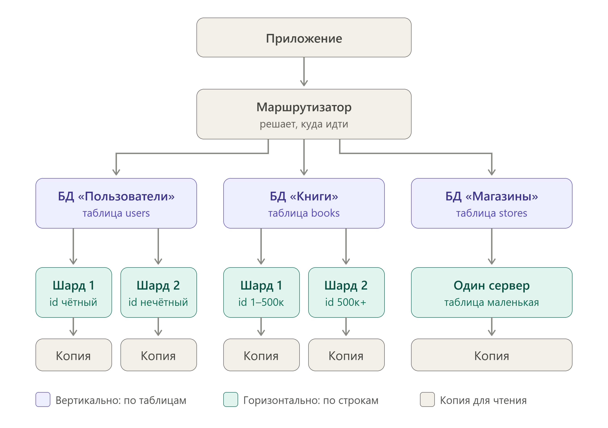

# Домашнее задание к занятию «Репликация и масштабирование. Часть 2»

## Задание 1
Опишите основные преимущества использования масштабирования методами:

активный master-сервер и пассивный репликационный slave-сервер;
master-сервер и несколько slave-серверов;
Дайте ответ в свободной форме.

### 1. Активный master + пассивный slave (репликация) 
master принимает все запросы на запись и чтение, а slave постоянно получает копию данных и просто «стоит наготове».

Главные плюсы:

Отказоустойчивость (главный смысл). Если master упадёт — slave можно быстро сделать новым master, и система продолжит работать. Данные не потеряются.

Резервная копия «на лету». Slave — это фактически живая копия базы. Можно делать бэкапы с него, не нагружая основной сервер.

Простота. Ничего не нужно менять в логике приложения — оно по-прежнему ходит на один адрес.

slave почти не помогает с нагрузкой — он только «страхует», а не разгружает.

### 2. Master + несколько slave-серверов
Как это работает: master принимает записи (и обычно часть чтений), а несколько slave-серверов раздают данные на чтение.

Главные плюсы:

Масштабирование чтения. Большинство сайтов читают гораздо чаще, чем пишут. Несколько slave делят между собой читательские запросы — нагрузка распределяется.

Географическая близость. Можно поставить slave в разных регионах — пользователи читают данные с ближайшего сервера, быстрее отвечает.

Повышенная отказоустойчивость. Упал один slave — остальные работают, система не замечает.

Гибкость. Можно добавлять slave по мере роста нагрузки (горизонтальное масштабирование).

Минус: записи всё равно упираются в один master, а данные между slave немного «отстают».

Коротко: первая схема — это про надёжность, вторая — про производительность чтения и масштаб.

## Задание 2
Разработайте план для выполнения горизонтального и вертикального шаринга базы данных. База данных состоит из трёх таблиц:

пользователи,
книги,
магазины (столбцы произвольно).
Опишите принципы построения системы и их разграничение или разбивку между базами данных.

Пришлите блоксхему, где и что будет располагаться. Опишите, в каких режимах будут работать сервера.

Что за таблицы
Пользователи (users): id, имя, email, город
Книги (books): id, название, автор, жанр, цена
Магазины (stores): id, название, город, адрес

Шардинг значит «разрезать» одну большую базу на несколько маленьких, чтобы один сервер не тонул в работе. Резать можно двумя способами.

Таблицы (столбцы я выбрал сам)
users: id, имя, email, город
books: id, название, автор, жанр, цена, store_id (в каком магазине лежит)
stores: id, название, город, адрес
Шаг 1. Вертикальный шардинг (режем по таблицам)

Каждая таблица живёт на своём сервере:

БД «Пользователи» хранит users. Там личные данные, и их удобно держать отдельно и защищать строже.
БД «Книги» хранит books. С этой таблицей работают чаще всего: поиск, каталог.
БД «Магазины» хранит stores. Это справочник, он меняется редко.

Так пользователи, которые листают каталог, не мешают тем, кто регистрируется.

Шаг 2. Горизонтальный шардинг (режем строки одной таблицы)

Если пользователей или книг станет очень много, одного сервера не хватит. Тогда одну таблицу делят на куски, и в каждом куске лежат свои строки, а столбцы те же.

users делим по id. Чётный id идёт на Шард 1, нечётный на Шард 2. Так пользователи делятся примерно поровну.
books делим по диапазону id. Книги с id от 1 до 500 тысяч лежат на Шарде 1, а те, что больше, на Шарде 2.
stores не делим. Магазинов мало (десятки или сотни), и разрезать такую таблицу нет смысла.

Всего получается 5 «рабочих» серверов: 2 для users, 2 для books и 1 для stores.

Кто что делает
Приложение — программа, которая обращается к базе.
Маршрутизатор — кусок кода между приложением и базами. Он смотрит на запрос и решает, куда его отправить. Например, пользователя с id = 7 он найдёт так: 7 нечётное, значит, Шард 2 в БД «Пользователи».
В каких режимах работают серверы

У каждого рабочего сервера есть копия, поэтому всего серверов 10.

Главный сервер принимает запись (добавить, изменить, удалить) и чтение. Он основной.
Копия постоянно копирует данные с главного. Она работает только на чтение: с неё берут данные для каталога и поиска, и главному становится легче. Копия может чуть отставать (на секунды), но для книжного магазина это не страшно.
Если главный сервер сломался, копия становится главным. Так данные не пропадают, а сайт продолжает работать. Новую копию потом поднимают заново.
Маршрутизатор сам ничего не хранит. Он только направляет запросы: записи идут на главные серверы, а чтение чаще на копии.
Что я заметил (минусы)
Данные из разных серверов нельзя соединить одним запросом (JOIN). Чтобы показать книгу с адресом магазина, приложение делает два запроса: сначала в «Книги», потом в «Магазины», и склеивает результат у себя.
Если понадобится третий шард, часть данных придётся переносить. Поэтому лучше сразу подумать о запасе.
Серверов стало больше, значит, и следить за ними сложнее, и стоят они дороже.

Дополнительные задания (со звёздочкой*)
Эти задания дополнительные, то есть не обязательные к выполнению, и никак не повлияют на получение вами зачёта по этому домашнему заданию. Вы можете их выполнить, если хотите глубже шире разобраться в материале.

## Задание 3*
Выполните настройку выбранных методов шардинга из задания 2.

Пришлите конфиг Docker и SQL скрипт с командами для базы данных.
